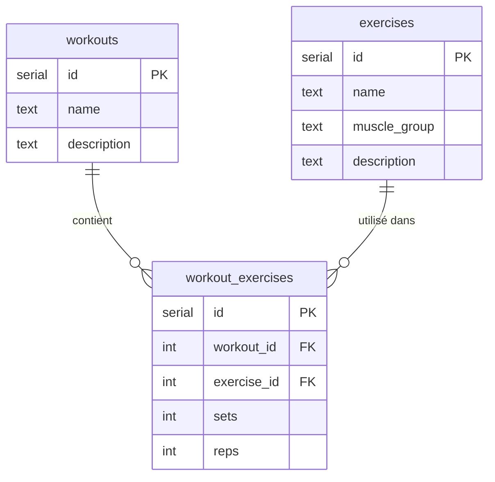

# Syvra Workout Builder

Petite application full-stack pour gérer des **séances d'entraînement** et leurs **exercices**, avec une relation **plusieurs-à-plusieurs** (un même exercice sert dans plusieurs séances, chaque fois avec ses propres séries/répétitions).

## 🔗 Liens

- **Site (front)** : https://syvra-workout-web.vercel.app
- **API** : https://syvra-workout-api.vercel.app/api/health
- **Dépôt GitHub** : https://github.com/Netstar123/syvra-workout-builder

## 🧱 Architecture

| Couche | Techno | Hébergement |
|---|---|---|
| Base de données | PostgreSQL | Neon |
| API REST | Node.js + Express + `pg` | Vercel (fonction serverless) |
| Front-end | React (Vite) + React Router | Vercel |
| Tests | Vitest | — |

```
web (React)  ──fetch──►  api (Express)  ──SQL──►  PostgreSQL (Neon)
                              │
                         repositories  ◄── tout le SQL est ici
```

## 🗃️ Schéma de la base (ERD)



La table de jonction `workout_exercises` porte **deux clés étrangères** et une contrainte
**`UNIQUE (workout_id, exercise_id)`** (un exercice ne peut pas être ajouté deux fois dans la
même séance). Les **séries/répétitions** y sont stockées car elles dépendent du **couple**
(séance + exercice), pas de l'exercice seul.

## 🧩 Design pattern : Repository

Tout le SQL vit dans des **repositories** (`ExerciseRepository`, `WorkoutRepository`,
`WorkoutExerciseRepository`). Les **routes Express ne font jamais de requête à la base**
directement : elles valident l'entrée, appellent le repository, et renvoient la réponse.

**Pourquoi ?** Ça sépare les responsabilités : si on change de base de données ou de requête,
on modifie **un seul endroit** (le repository), pas toutes les routes. C'est aussi ce qui rend
les **tests unitaires** faciles : on peut simuler (mock) la base et tester le repository seul.

```
route (exercises.js)  ──►  ExerciseRepository.findAll()  ──►  SQL  ──►  PostgreSQL
   (aucun SQL ici)              (le SQL est ici)
```

## 📡 Endpoints de l'API

| Méthode | Route | Rôle |
|---|---|---|
| GET | `/api/health` | vérifie que l'API tourne |
| GET | `/api/exercises` | liste (filtre `?muscle_group=`) |
| GET | `/api/exercises/:id` | un exercice + séances qui l'utilisent |
| POST/PUT/DELETE | `/api/exercises/:id` | CRUD exercice |
| GET | `/api/workouts` | liste des séances |
| GET | `/api/workouts/:id` | une séance + ses exercices (sets/reps) |
| POST/PUT/DELETE | `/api/workouts/:id` | CRUD séance |
| POST | `/api/workouts/:id/exercises` | ajouter un exercice à la séance |
| PUT | `/api/workouts/:id/exercises/:linkId` | modifier sets/reps |
| DELETE | `/api/workouts/:id/exercises/:linkId` | retirer l'exercice de la séance |

## ▶️ Lancer en local

```bash
# 1) Base de données
#   Crée une base Neon, copie api/.env.example -> api/.env et mets DATABASE_URL

# 2) API
cd api
npm install
npm run db:setup   # crée les tables + données de test
npm start          # http://localhost:3000

# 3) Front
cd ../web
npm install
npm run dev        # http://localhost:5173
```

## 🧪 Tests

```bash
cd api && npm test   # tests des repositories (base simulée)
cd web && npm test   # test du custom hook useFetch
```

## 🤖 Outils IA utilisés

Ce projet a été construit avec l'aide de **Claude (Claude Code)** pour :
le schéma de la base, le code de l'API (Repository pattern), les composants React, et les tests.
**Tout le code a été relu et est compris** par l'auteur (le pattern, la relation
plusieurs-à-plusieurs, le flux front → API → base).
